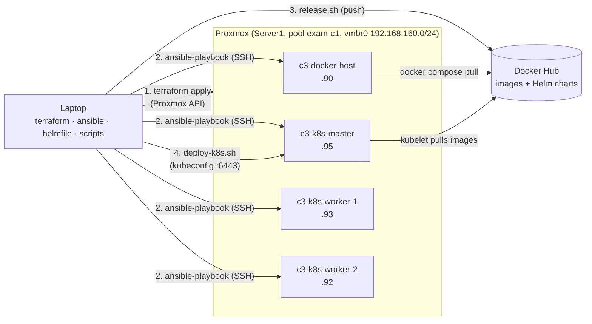
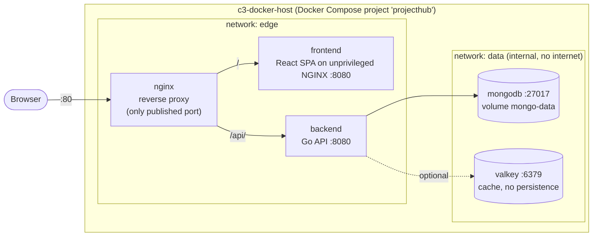
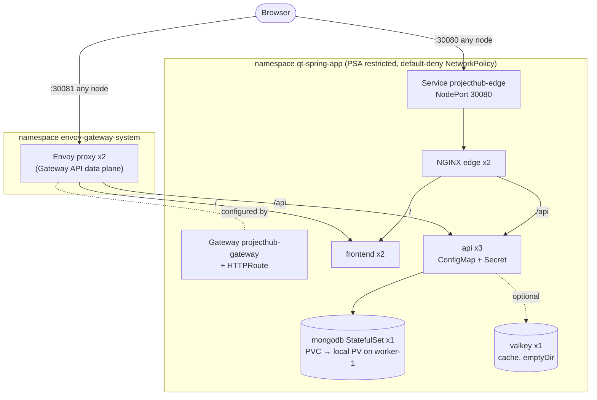

# ProjectHub: DevOps Practical Exam (Challenge A)

| Candidate | Proxmox pool | Proxmox user |
|---|---|---|
| **Candidate 1** | `exam-c1` | `candidate1@pve` |

This repository delivers **ProjectHub** (Go API, React frontend, MongoDB, Valkey/Redis cache) end to end:

1. **Terraform** creates 4 VMs on Proxmox.
2. **Ansible** configures them: Docker on one VM, a 3-node Kubernetes cluster on the others.
3. The app runs **twice**: with **Docker Compose** on the Docker host, and with **Helm + Helmfile** on Kubernetes.
4. **Monitoring** evidence and a **resilience demo** prove it works.

Everything is code, idempotent (safe to re-run), and uses pinned, immutable versions.

---

## Contents

1. [Quick facts: URLs, VMs, logins](#1-quick-facts)
2. [Repository layout](#2-repository-layout)
3. [Architecture: the whole stack](#3-architecture)
4. [The application and its Docker images](#4-the-application-and-its-docker-images)
5. [Task 1: Infrastructure with Terraform](#5-task-1--infrastructure-with-terraform)
6. [Task 2: Docker Compose deployment](#6-task-2--docker-compose-deployment)
7. [Task 3: Kubernetes cluster with Ansible](#7-task-3--kubernetes-cluster-with-ansible)
8. [Task 4: ProjectHub on Kubernetes (Helm, Helmfile, Gateway API)](#8-task-4--projecthub-on-kubernetes)
9. [Task 5: Monitoring and screenshots](#9-task-5--monitoring)
10. [**Runbook: build everything from zero, step by step**](#10-runbook)
11. [Security](#11-security)
12. [Troubleshooting: problems we hit and how they were fixed](#12-troubleshooting)
13. [Submission checklist](#13-submission-checklist)

---

## 1. Quick facts

### Where to open the app

| Deployment | URL | Path through the stack |
|---|---|---|
| Docker Compose | **http://192.168.160.90** | NGINX :80 → frontend / API |
| Kubernetes, NodePort (required) | **http://192.168.160.95:30080** (works on any node IP) | NodePort → NGINX edge → frontend / API |
| Kubernetes, Gateway API (bonus) | **http://192.168.160.95:30081** (works on any node IP) | Envoy Gateway → HTTPRoute → frontend / API |

Health check on any of them: append `/api/health`. The expected answer is `{"status":"ok","database":"up","cache":"up"}`.

### The VMs

| VM ID | Hostname | IP (DHCP) | Role | Size |
|---|---|---|---|---|
| 4101 | `c3-docker-host` | 192.168.160.90 | Docker Engine + Compose | 4 vCPU, 4 GiB, 30 GB |
| 4102 | `c3-k8s-master` | 192.168.160.95 | Kubernetes control plane | 4 vCPU, 4 GiB, 30 GB |
| 4103 | `c3-k8s-worker-1` | 192.168.160.93 | Kubernetes worker (holds MongoDB's disk) | 4 vCPU, 4 GiB, 30 GB |
| 4104 | `c3-k8s-worker-2` | 192.168.160.92 | Kubernetes worker | 4 vCPU, 4 GiB, 30 GB |

All VMs run Ubuntu 24.04 (cloned from template 9000). The login is user `devops` with an SSH key: `ssh -i ~/.ssh/qt_exam_ed25519 devops@<ip>`.

### Application logins (test data)

The application creates these accounts itself, the first time the API starts on an empty database (`SEED_ENABLED=true`, as the exam app provides):

| Role | Email | Password |
|---|---|---|
| admin | admin@qt.rw | Admin@123 |
| manager | manager@qt.rw | Manager@123 |
| member | member@qt.rw | Member@123 |

### What is published on Docker Hub (account `ishimwejeanluc`)

| Kind | Name | Version |
|---|---|---|
| Image | `ishimwejeanluc/projecthub-api` | `1.0.0` |
| Image | `ishimwejeanluc/projecthub-frontend` | `1.0.0` |
| Helm charts (OCI) | `oci://registry-1.docker.io/ishimwejeanluc/projecthub-{api,frontend,edge,gateway,mongodb,valkey}-chart` | `1.0.0` |

---

## 2. Repository layout

```
.
├── iac/          Task 1  Terraform: 4 Proxmox VMs (reusable module) + generated Ansible inventory
├── ansible/      Task 2/3 Ansible roles: Docker host, Kubernetes cluster, cluster add-ons, app prerequisites
├── docker/       Task 2  Dockerfiles, docker-compose.yml, NGINX config, .env.example
├── k8s/          Task 4  Helm charts (one per service + a shared library chart), helmfile, values
├── scripts/      Build/push images, publish charts, deploy to Kubernetes, resilience demo
├── monitoring/   Task 5  Screenshots and the resilience-demo output
└── app/          The ProjectHub source code (given by the exam, not modified)
```

More detail lives next to the code: [k8s/README.md](k8s/README.md) and [scripts/README.md](scripts/README.md).

---

## 3. Architecture

### 3.1 Infrastructure: who builds what



### 3.2 Deployment A: Docker Compose on `c3-docker-host`



- **Only NGINX publishes a port** (80). MongoDB and Valkey sit on an `internal` network: they cannot be reached from the LAN or reach the internet.
- **Start order** comes from health checks. NGINX waits for a healthy frontend and API, and the API waits for a healthy MongoDB. The API does **not** wait for Valkey, because the cache is optional.
- **MongoDB data** is kept in the named volume `mongo-data`, so it survives container restarts and re-creates.

### 3.3 Deployment B: Kubernetes (namespace `qt-spring-app`)



- **One Helm release per service.** Helmfile deploys them in order: mongodb, valkey → api → frontend → edge → gateway.
- **Pods spread across both workers** (topology spread on hostname). The API runs 3 replicas, and the frontend and edge run 2 each.
- **Calico** is the CNI and enforces the NetworkPolicies. **Envoy Gateway** implements the Gateway API.

### 3.4 Request flow (same in both deployments)

1. The browser loads `/`, which the reverse proxy sends to the **frontend**. The frontend returns the React app.
2. The React app calls `/api/...` on the **same address**, which the proxy sends to the **API**. Because it is the same origin, there are no CORS problems and no hard-coded hostnames.
3. The API reads and writes **MongoDB** (the source of truth).
4. Dashboard statistics and user lookups are cached in **Valkey** for 1–2 minutes. On a cache miss, or when Valkey is down, the API simply reads MongoDB.

---

## 4. The application and its Docker images

ProjectHub is a project manager with JWT login and three roles (admin, manager, member), projects, teams and a task board. Source: [app/](app/).

| Part | Technology | Image | How it is built |
|---|---|---|---|
| API | Go + Gin | `ishimwejeanluc/projecthub-api:1.0.0` | [docker/Dockerfile.backend](docker/Dockerfile.backend) |
| Frontend | React 18 + Vite | `ishimwejeanluc/projecthub-frontend:1.0.0` | [docker/Dockerfile.frontend](docker/Dockerfile.frontend) |
| Database | MongoDB | `mongo:7.0.48` (official) | not built |
| Cache | Valkey (Redis-compatible) | `valkey/valkey:8.1.12-alpine` (official) | not built |
| Reverse proxy | NGINX | `nginx:1.30.7-alpine` (official), on Compose only | not built |

### 4.1 How the images are built (multi-stage)

A multi-stage build uses one image with all the build tools to **compile**, then copies only the result into a small, clean image to **run**. Compilers, source code and `node_modules` never reach production.

**API ([Dockerfile.backend](docker/Dockerfile.backend))**
1. **Stage 1** (`golang:1.26.3-alpine3.22`):
   - `go mod download` runs first, so the dependency layer is cached when only code changes.
   - It then compiles a static binary (`CGO_ENABLED=0`, `-trimpath -ldflags="-s -w"`, which strips debug data).
2. **Stage 2** (`alpine:3.22.8`): only the binary, CA certificates and timezone data.
   - Runs as the non-root user `app`.
   - Has a `HEALTHCHECK` on `/api/health`.

**Frontend ([Dockerfile.frontend](docker/Dockerfile.frontend))**
1. **Stage 1** (`node:20.20.2-alpine3.22`): `npm ci` (exact lockfile), then `npm run build`, with `VITE_API_URL=/api` so the app calls its own origin.
2. **Stage 2** (`nginxinc/nginx-unprivileged:1.30.6-alpine`): serves the static `dist/` folder on port 8080 as a non-root user.
   - SPA fallback: unknown paths return `index.html`.
   - Hashed assets are cached for a year.

### 4.2 Image rules

- **Every base image is pinned** by version **and** `sha256` digest, so a rebuild uses exactly the same base.
- **Short but immutable app tags** (`1.0.0`). `scripts/build-push-images.sh` refuses to overwrite a tag that already exists on Docker Hub. To ship a change, bump `IMAGE_TAG` in `docker/.env`.
- **No secrets in images.** All configuration comes from environment variables at run time.
- **`.dockerignore` files** keep `node_modules`, `.git` and `.env` out of the build context.

---

## 5. Task 1: Infrastructure with Terraform

**Folder:** [iac/](iac/). **Provider:** `bpg/proxmox`.

| File | Purpose |
|---|---|
| `modules/proxmox-vm/` | **Reusable module**: clones the template, sets CPU, RAM, disk and network, injects cloud-init (user, SSH key, DHCP), enables the QEMU guest agent and returns the VM's IP |
| `main.tf` | Calls the module once per VM with `for_each` over the `vms` map |
| `variables.tf` | Proxmox endpoint, node, pool, template, network and VM sizing, all with defaults |
| `terraform.tfvars.example` | Copy to `terraform.tfvars` (git-ignored) and fill in the password and token |
| `inventory.tf` + `templates/hosts.ini.tftpl` | **Writes the Ansible inventory** (`ansible/inventory/hosts.ini`) from the real DHCP IPs |
| `outputs.tf` | VM IPs, IDs, MACs and ready-to-use SSH commands |

**Key decisions:**
- **DHCP, as the exam says.** Terraform does not choose IPs. The guest agent reports the IP DHCP gave each VM, and Terraform writes it into the inventory. Adding a VM is one line in the `vms` map, and the inventory follows automatically.
- **`cpu_type = "x86-64-v3"`.** MongoDB 5+ needs AVX CPU instructions. With the default CPU type, MongoDB crashed with exit code 132 (illegal instruction).
- **Secrets stay out of Git.** The API token and VM password live in `terraform.tfvars` (git-ignored), or in `TF_VAR_proxmox_api_token_secret`.

---

## 6. Task 2: Docker Compose deployment

**Folder:** [docker/](docker/). **Host:** `c3-docker-host`.

1. **Ansible prepares the host** with [playbooks/docker-host.yml](ansible/playbooks/docker-host.yml):
   - Role `common`: base packages, and the root disk grown to the full size.
   - Role `docker_engine`: Docker Engine and the Compose plugin from Docker's official apt repo, plus the `devops` user in the `docker` group.
2. **The app is deployed by hand** with Compose. Copy `docker-compose.yml`, `nginx.conf` and `.env` to `~/projecthub`, then run `docker compose up -d` (exact commands in the [runbook](#step-6--deploy-with-docker-compose-on-c3-docker-host)).

**One settings file:** [docker/.env.example](docker/.env.example) lists every value:
- image names and tags,
- MongoDB user and password,
- the Valkey password,
- the JWT secret,
- `SEED_ENABLED`.

The real `docker/.env` is git-ignored, `chmod 600`, and is also used by the scripts and by Ansible to create the Kubernetes Secret, so every secret is defined in one place.

### Does Redis/Valkey need persistence? No.

- Valkey only holds **copies** of data, with short TTLs (1–2 minutes). MongoDB is the source of truth.
- If the cache disappears, the API reads MongoDB instead. The app stays up, just slightly slower, and no data is lost.
- So Valkey runs with `--save '' --appendonly no` (no disk), `--maxmemory 256mb --maxmemory-policy allkeys-lru` (evicts the oldest keys instead of failing), and a password (`--requirepass`).
- **MongoDB must persist**: a named volume in Compose, and a PV/PVC in Kubernetes.

This was **proven on Kubernetes**: with Valkey scaled to 0, `/api/health` reported `"cache":"down"`, and login plus 20/20 requests still returned HTTP 200 (see [section 8.4](#84-resilience-demo)).

---

## 7. Task 3: Kubernetes cluster with Ansible

**Folder:** [ansible/](ansible/). **Playbook:** [playbooks/k8s-cluster.yml](ansible/playbooks/k8s-cluster.yml).

| Role | Runs on | What it does |
|---|---|---|
| `common` | all | Base packages, full-size root LV |
| `containerd` | k8s nodes | containerd 2.x from Docker's repo, `SystemdCgroup = true` |
| `k8s_node` | k8s nodes | Swap off, kernel modules (`overlay`, `br_netfilter`), sysctl, `kubeadm`/`kubelet`/`kubectl` **v1.35**, pinned and held |
| `k8s_control_plane` | master | `kubeadm init` **only if not yet initialised**, then saves the kubeconfig to `ansible/kubeconfig` on the laptop |
| `k8s_worker` | workers | `kubeadm join` **only if the node has not joined yet** |
| `k8s_addons` | master | Installs the add-ons below, each one diffed first so it is applied only if something changed |
| `docker_repo` | (dependency) | Docker's apt repo, shared by `docker_engine` and `containerd` |

The add-ons installed by `k8s_addons`:
- **Calico v3.33.1** (Tigera operator), with pod CIDR `10.244.0.0/16`, which does not overlap the LAN.
- **metrics-server**, so `kubectl top` works.
- **Gateway API CRDs v1.6.1** and **Envoy Gateway v1.10.0** (for the bonus).

**Result:** 3 nodes `Ready`, Kubernetes v1.35.10, containerd 2.4.2 (see [k8s-nodes.png](monitoring/k8s-nodes.png)).

**Idempotent:** a second run of the playbook reports `changed=0`. Nothing is reset, re-initialised or re-joined.

---

## 8. Task 4: ProjectHub on Kubernetes

Full details: [k8s/README.md](k8s/README.md).

### 8.1 How it is packaged

- **6 Helm charts, one per service:** `projecthub-{mongodb,valkey,api,frontend,edge,gateway}-chart`.
- **One resource per template file:** `deployment.yaml`, `service.yaml`, `configmap.yaml`, and so on.
- **A library chart, `projecthub-lib`**, holds the shared parts once: labels, security contexts, probes, ServiceAccount, Service, PDB and NetworkPolicy.
- **Charts are published to Docker Hub as OCI artifacts**, next to the images.
- **[helmfile.yaml.gotmpl](k8s/helmfile.yaml.gotmpl) declares the 6 releases**, their pinned versions and their order (`needs`).

**Why separate releases instead of one big chart?** Each service is deployed and rolled back on its own. Rolling back a frontend bug never touches the database.

**Why the charts look the way they do:** every chart was checked against a production-readiness checklist with 24 items in three pillars: Reliability, Security, and Workflow & Governance. [k8s/README.md, "Production-readiness checklist"](k8s/README.md#production-readiness-checklist-what-we-did-and-why) explains each item: what we did, why it matters, and what is left for production.

The short version:
- **Probes, PDBs and spread:** every pod has requests, limits and probes. The API, frontend and edge have 2–3 replicas with PDBs, `maxUnavailable: 0`, and spread across both workers.
- **Locked-down pods:** non-root, read-only root filesystem, no capabilities, no ServiceAccount token, and namespace Pod Security `restricted`.
- **Closed network:** default-deny ingress, and only the API can reach MongoDB and Valkey.
- **No secrets in Helm:** the charts reference an existing Secret by name.
- **Safe deploys:** immutable, pinned chart and image versions, `helm lint --strict`, a diff before every apply, and atomic rollback.
- **Not done yet (honest gaps):**
  - egress NetworkPolicies;
  - `helm unittest` tests;
  - sops-encrypted secrets;
  - drift detection on a schedule (today it is run by hand).

### 8.2 Exam requirements and where they are met

| Requirement | Implementation |
|---|---|
| Namespace | `qt-spring-app`, with Pod Security "restricted" and a default-deny NetworkPolicy ([k8s/namespace.yaml](k8s/namespace.yaml)) |
| Deployments / StatefulSet | Deployments: api x3, frontend x2, edge x2, valkey x1. StatefulSet: mongodb x1 |
| Services | ClusterIP: api, frontend, valkey. Headless: mongodb. **NodePort 30080**: edge |
| ConfigMaps | `projecthub-api-config` (GIN mode, Mongo host, DB name, cache settings), `projecthub-edge-nginx` (nginx.conf) |
| Secrets | `projecthub-secrets` (JWT secret, MongoDB user and password, Valkey password), created by Ansible from `docker/.env`, **never stored in Helm values** |
| PV + PVC | `projecthub-mongodb-pv`: local, 5Gi, on worker-1, `Retain`, and kept even on `helm uninstall`. Bound to the PVC `projecthub-mongodb-data` |
| Probes | API: startup, readiness and liveness on `/api/health`. Frontend and edge: readiness and liveness |
| Requests and limits | On every container. The API sets `GOMEMLIMIT=200MiB` under a 256Mi limit, the Go equivalent of a JVM heap setting |
| Resilience | 3 API replicas, PodDisruptionBudgets, rolling updates with `maxUnavailable: 0`, spread over both workers |
| Helm (bonus) | 6 charts + library chart, OCI registry, Helmfile, atomic upgrades |
| Gateway API (bonus) | GatewayClass, EnvoyProxy (NodePort 30081), Gateway and HTTPRoute, on Envoy Gateway |

### 8.3 Why NodePort **and** Gateway API?

- **NodePort 30080** is what the exam requires, and it is the simplest path: NodePort → NGINX → app.
- **Gateway API on 30081** is the bonus. It is the modern, standard replacement for Ingress.
- Both run side by side and route to the **same** frontend and API Services, so either URL can be tested independently.
- Without a cloud load balancer, Envoy's own Service is exposed as a NodePort too.

### 8.4 Resilience demo

`scripts/resilience-demo.sh` runs these tests. The raw output is in [monitoring/k8s-resilience-demo.txt](monitoring/k8s-resilience-demo.txt).

| Test | Result |
|---|---|
| API scaled to 3, one API pod deleted while requests flow | **101/101 requests HTTP 200** |
| Valkey (cache) scaled to 0 | Health shows `"cache":"down"`, login still works, **20/20 requests HTTP 200** |
| Valkey restored | Health shows `"cache":"up"` again |

Data persistence was tested separately: users and projects were still there after the MongoDB pod was deleted, and after the move from the first single-chart release to the per-service releases (same PV/PVC).

When the script ends, the cluster matches Helm again, so a later `deploy-k8s.sh --diff` reports no changes.

---

## 9. Task 5: Monitoring

All screenshots are in [monitoring/](monitoring/). Every terminal screenshot starts with a banner `=== <hostname> | <date time> | <what it shows> ===`, so the VM and the time are visible.

### 9.1 VM health: 7 screenshots per VM

| File (N = 1..4) | Command | What it shows |
|---|---|---|
| `vmN-top.png` (`vm1-htop.png` for the Docker host) | `top` / `htop` | CPU per core, memory, load average, busiest processes |
| `vmN-df.png` | `df -hT` | Disk usage per filesystem (root LV grown to the full disk) |
| `vmN-free.png` | `free -h` | Total, used and available RAM, swap (off on k8s nodes) |
| `vmN-uptime.png` | `uptime` | Time since boot and 1/5/15-minute load |
| `vmN-ss.png` | `sudo ss -tulpn` | Listening ports and the process behind each one |
| `vmN-ps.png` | `ps aux --sort=-%cpu` | Processes sorted by CPU and memory use |
| `vmN-iostat-vmstat.png` | `iostat -xz`, `vmstat` | Disk I/O, wait times, memory and CPU over time |

VM numbers: **vm1** = c3-docker-host (.90), **vm2** = c3-k8s-master (.95), **vm3** = c3-k8s-worker-1 (.93), **vm4** = c3-k8s-worker-2 (.92).

### 9.2 Docker host: the Compose application

| Screenshot | What it shows |
|---|---|
| [docker-ps.png](monitoring/docker-ps.png) | `docker compose ps`: all 5 containers `Up (healthy)`, the pushed images `projecthub-api:1.0.0` and `projecthub-frontend:1.0.0`, and only NGINX published on port 80 |
| [docker-stats.png](monitoring/docker-stats.png) | `docker stats`: live CPU, memory, network and disk I/O per container (MongoDB is the largest at about 383 MiB, the API about 22 MiB) |
| [docker-api-logs.png](monitoring/docker-api-logs.png) | The last 50 API log lines: the health checks every 15 s, all HTTP 200, in about 1 ms |
| [docker-redis.png](monitoring/docker-redis.png) | Valkey (Redis): cached keys, memory used versus the 256 MB limit, keyspace hits and misses |
| [docker-health.png](monitoring/docker-health.png) | `/api/health` → `{"status":"ok","database":"up","cache":"up"}` and every service `healthy` |

### 9.3 Kubernetes cluster and application

| Screenshot | What it shows |
|---|---|
| [k8s-nodes.png](monitoring/k8s-nodes.png) | 3 nodes `Ready`, v1.35.10, Ubuntu 24.04.5, containerd 2.4.2 |
| [k8s-pods.png](monitoring/k8s-pods.png) | All pods in every namespace `Running` (Calico, Envoy Gateway, kube-system, `qt-spring-app`), spread over both workers |
| [k8s-top.png](monitoring/k8s-top.png) | `kubectl top` (metrics-server): node CPU and memory, and per-pod usage of the app (API pods about 10 Mi each, MongoDB about 95 Mi) |
| [k8s-health.png](monitoring/k8s-health.png) | `/api/health` OK on **both** :30080 (NodePort) and :30081 (Gateway), plus the Services, the Gateway (`PROGRAMMED True`) and the HTTPRoute |

---

## 10. Runbook

A step-by-step guide to build everything from an empty Proxmox pool. Each step says **where** to run it, **what** it does, and **how to check** it worked. All the steps are safe to re-run.

> Commands run from the **repository root on the laptop**, unless the step says otherwise.

### Step 0: Tools on the laptop

| Tool | Used for |
|---|---|
| `terraform` ≥ 1.5 | Task 1 |
| `ansible` | Tasks 2 and 3 |
| `docker` with buildx | Building images |
| `kubectl`, `helm` 4, `helmfile`, the `helm-diff` plugin | Task 4 |

```bash
helm plugin install https://github.com/databus23/helm-diff --version v3.15.15 --verify=false
cd ansible && ansible-galaxy collection install -r requirements.yml && cd ..
```

You also need an SSH key for the VMs. Create one once:
```bash
ssh-keygen -t ed25519 -f ~/.ssh/qt_exam_ed25519 -N ""
```

### Step 1: Fill in the secrets (once)

```bash
cp iac/terraform.tfvars.example iac/terraform.tfvars     # VM password; the API token goes here or in TF_VAR_proxmox_api_token_secret
cp docker/.env.example docker/.env && chmod 600 docker/.env
```
Edit `docker/.env`:
- set `DOCKERHUB_USER` and `DOCKERHUB_TOKEN` (a Docker Hub "Read & Write" access token);
- replace every `change-me` with random values, for example `openssl rand -hex 16`, and `openssl rand -hex 32` for `JWT_SECRET`.

Both files are git-ignored.

### Step 2: Create the 4 VMs (Terraform)

```bash
cd iac
terraform init          # downloads the Proxmox and local providers
terraform plan          # shows 4 VMs + 1 inventory file to create
terraform apply         # about 3-5 minutes; waits until each VM reports its IP
terraform output        # vm_ips, ssh_commands
cd ..
```
**What happens:**
1. Terraform clones template 9000 four times (VM IDs 4101–4104).
2. Cloud-init creates the `devops` user with your SSH key, and DHCP gives each VM an IP.
3. The guest agent reports those IPs, and Terraform writes them into `ansible/inventory/hosts.ini`.

**Check:** `cat ansible/inventory/hosts.ini` lists 4 IPs, and `ssh -i ~/.ssh/qt_exam_ed25519 devops@<ip> hostname` answers.

### Step 3: Configure the Docker host (Ansible)

```bash
cd ansible
ansible all -m ping                              # all 4 VMs answer "pong"
ansible-playbook playbooks/docker-host.yml
```
**What happens:** base packages, the full-size disk, Docker Engine and the Compose plugin on `c3-docker-host`.
**Check:** run it again. The recap shows `changed=0`.

### Step 4: Build the Kubernetes cluster (Ansible)

```bash
ansible-playbook playbooks/k8s-cluster.yml      # still inside ansible/
cd ..
```
**What happens, in order:**
1. **All 3 nodes:** containerd, kernel settings, kubeadm, kubelet and kubectl v1.35.
2. **Master:** `kubeadm init`.
3. **Workers:** `kubeadm join`.
4. **Add-ons:** Calico, metrics-server, Gateway API CRDs and Envoy Gateway.
5. **Kubeconfig:** saved to `ansible/kubeconfig` on the laptop.

**Check:**
```bash
export KUBECONFIG=$PWD/ansible/kubeconfig
kubectl get nodes          # 3 nodes Ready
kubectl get pods -A        # everything Running
```

> Shortcut: `ansible-playbook playbooks/site.yml` runs steps 3 and 4 together.

### Step 5: Build and publish the images and charts

```bash
./scripts/release.sh
```
**What happens:**
1. It logs in to Docker Hub with the token from `docker/.env`.
2. It builds and pushes `projecthub-api` and `projecthub-frontend` at `IMAGE_TAG`.
3. For each of the 6 charts, it runs `helm lint --strict`, then `helm package` and `helm push` to `oci://registry-1.docker.io/<user>/`.

**Check:** run it again. Every line says `already exists - immutable, skipped`.

> To release a change: bump `IMAGE_TAG` in `docker/.env` (code change) or `version` in the chart's `Chart.yaml` (template change), then run it again.

### Step 6: Deploy with Docker Compose (on c3-docker-host)

**On the laptop**, copy the three files. `.env` is sent **without** the Docker Hub token, which the VM does not need:
```bash
ssh -i ~/.ssh/qt_exam_ed25519 devops@192.168.160.90 'mkdir -p ~/projecthub'
scp -i ~/.ssh/qt_exam_ed25519 docker/docker-compose.yml docker/nginx.conf devops@192.168.160.90:~/projecthub/
grep -v '^DOCKERHUB_TOKEN' docker/.env | ssh -i ~/.ssh/qt_exam_ed25519 devops@192.168.160.90 'umask 077; cat > ~/projecthub/.env'
```
**On c3-docker-host** (`ssh -i ~/.ssh/qt_exam_ed25519 devops@192.168.160.90`):
```bash
cd ~/projecthub
docker compose pull            # pulls the exact images from Docker Hub
docker compose up -d           # starts mongodb + valkey, then backend + frontend, then nginx
docker compose ps              # after about 30 s, all 5 services show "(healthy)"
curl -s http://localhost/api/health
```
**Check:** open **http://192.168.160.90** and log in as `admin@qt.rw` / `Admin@123`.

### Step 7: Prepare the cluster for the app (Ansible)

```bash
cd ansible && ansible-playbook playbooks/k8s-app-prereqs.yml && cd ..
```
**What happens:** this playbook does what Helm can't or shouldn't do:
1. Creates MongoDB's data directory on worker-1 (owner 999, mode 2770).
2. Creates the namespace `qt-spring-app`, with Pod Security "restricted" and default-deny.
3. Creates the Secret `projecthub-secrets` from `docker/.env`. The values are sent through stdin, so they never appear in logs, Helm values or Helm history.

Run it again only after changing secrets.

### Step 8: Deploy to Kubernetes (Helmfile)

```bash
./scripts/deploy-k8s.sh --diff     # preview: what would change? (changes nothing)
./scripts/deploy-k8s.sh            # deploy
```
**What happens:**
1. **Preflight:** checks the tools, the helm-diff plugin, cluster access, the namespace and the Secret.
2. **Diff:** `helmfile diff` compares the charts with the **live** cluster.
3. **Apply only if needed:**
   - nothing differs → it stops (no new Helm revisions);
   - something differs → `helmfile apply` upgrades **only** the releases that changed, in order. A failed upgrade is rolled back automatically.
4. **Verify:** every release is `deployed`, every pod is `Ready`, and `/api/health` answers on :30080 and :30081.

**Check:** open **http://192.168.160.95:30080** and **http://192.168.160.95:30081**.

### Step 9: Resilience demo (optional evidence)

```bash
KUBECONFIG=ansible/kubeconfig ./scripts/resilience-demo.sh > monitoring/k8s-resilience-demo.txt
```
This deletes an API pod while traffic flows, then stops and restores the cache. Read the results in the output file.

### Step 10: Monitoring screenshots

Run the commands in [section 9](#9-task-5--monitoring) on each VM and save the screenshots in `monitoring/` with the names shown there.

### Everyday operations

| I want to... | Command |
|---|---|
| See whether the cluster has drifted from the charts | `./scripts/deploy-k8s.sh --diff` |
| Repair drift (for example after a manual `kubectl scale`) | `./scripts/deploy-k8s.sh` |
| Ship a new app version | Bump `IMAGE_TAG` in `docker/.env` → `./scripts/release.sh` → `./scripts/deploy-k8s.sh` (the helmfile reads `IMAGE_TAG` from the environment, so only the API and frontend releases change). On Compose: set the same `IMAGE_TAG` in `~/projecthub/.env`, then `docker compose pull && docker compose up -d` |
| Roll a release back | `helm history projecthub-api -n qt-spring-app`, then `helm rollback projecthub-api <rev> -n qt-spring-app` |
| Look at logs | Compose: `docker compose logs -f backend`. K8s: `kubectl logs -n qt-spring-app deploy/projecthub-api -f` |
| Restart the Compose stack | `cd ~/projecthub && docker compose restart` |
| Tear down the VMs | `cd iac && terraform destroy` |

---

## 11. Security

- **No secrets in Git:**
  - `.gitignore` covers `*.tfvars`, `*.tfstate`, `.env`, `kubeconfig` and SSH keys.
  - Only `*.example` files are committed.
- **One secret source** (`docker/.env`, mode 600). Secrets reach Kubernetes as a Secret created over stdin with `no_log`, never through Helm values or shell arguments.
- **Containers run as non-root:**
  - The API runs as user `app`, the frontend on unprivileged NGINX, and MongoDB as uid 999.
  - On Kubernetes: `runAsNonRoot`, all capabilities dropped, no privilege escalation, seccomp `RuntimeDefault`, and a read-only root filesystem.
- **The network is closed by default:**
  - Compose: the data tier is on an `internal` network, and only NGINX has a host port.
  - Kubernetes: a default-deny NetworkPolicy, plus one allow-list per service. Only the edge and the gateway accept traffic from outside.
- **Pinned versions everywhere:** base images by digest, app images and charts immutable, Kubernetes packages held at v1.35.
- **Passwords on every data service:** MongoDB authentication and Valkey `requirepass`, with neither reachable from the LAN.
- **Not done in this lab:** an external secret store (sops / External Secrets), TLS, and CI scanning are the next steps for production.

---

## 12. Troubleshooting

Problems met during the build and how they were solved:

| Symptom | Cause | Fix |
|---|---|---|
| MongoDB container exits with code **132** | The VM CPU type lacked AVX, which MongoDB 5+ requires | `cpu_type = "x86-64-v3"` in Terraform |
| Terraform could not read the VM IPs (HTTP 403) | The API token lacked `VM.GuestAgent.Audit` | The permission was granted on the token |
| `Error acquiring the state lock` | A `terraform plan` suspended with Ctrl+Z still held the lock | Stop that process, then re-run |
| VMID already in use | IDs collided with other VMs on the server | Moved to IDs 4101–4104 |
| Root disk only half used | Ubuntu's LVM leaves free space in the volume group | `lvextend -r` in the `common` role |
| `docker push` denied | Stale Docker Hub login | The scripts log in with `DOCKERHUB_TOKEN` from `.env` |
| API pods restarting on the first deploy | MongoDB was still starting | Longer Mongo connect timeout and a startup probe |
| Gateway :30081 did not answer on the master | `externalTrafficPolicy: Local` only answers on nodes running Envoy | Changed it to `Cluster` |
| `helmfile diff` missed a manual `kubectl scale` | helm-diff compared with the stored release, not the cluster | `HELM_DIFF_THREE_WAY_MERGE=true` in `deploy-k8s.sh` |
| Re-running the add-ons always showed changes | Server-filled defaults (Calico IP pools, Secret `stringData`) | Declared the defaults explicitly, and used base64 `data` |

---

## 13. Submission checklist

Status legend: ✅ done and verified, 🟡 done with a gap (explained), ➖ not done (reason given).

### Tasks and evidence

| Task | Status | Evidence (how it was verified) |
|---|---|---|
| 1. Terraform: 4 VMs from template 9000 | ✅ | `terraform validate` passes; `terraform plan` reports **No changes**. `ansible all -m ping` works; hostnames, Ubuntu 24.04 and 4 CPU / 4 GiB / 30 GB match |
| 2. Docker Compose: 5 services behind NGINX | ✅ | All 5 services `healthy` ([docker-ps.png](monitoring/docker-ps.png), [docker-health.png](monitoring/docker-health.png)). Only port 80 is published. End-to-end API test passed (below) |
| 2. Images on Docker Hub | ✅ | `projecthub-api:1.0.0` and `projecthub-frontend:1.0.0`; `release.sh` reports both already exist (immutable) |
| 3. Kubernetes with Ansible | ✅ | 3 nodes `Ready`, v1.35.10, containerd 2.4.2, Calico ([k8s-nodes.png](monitoring/k8s-nodes.png), [k8s-pods.png](monitoring/k8s-pods.png)). Every playbook passes `--syntax-check`; a second run reports `changed=0` |
| 4. App on Kubernetes (namespace `qt-spring-app`) | ✅ | api 3/3, frontend 2/2, edge 2/2, valkey 1/1, mongodb 1/1; PVC `Bound`; `deploy-k8s.sh --diff` reports no drift |
| 4. NodePort access | ✅ | `/api/health` OK on :30080 from several node IPs ([k8s-health.png](monitoring/k8s-health.png)) |
| 4. Resilience A: 3 replicas, pod deleted | ✅ | 101/101 requests HTTP 200 ([k8s-resilience-demo.txt](monitoring/k8s-resilience-demo.txt)) |
| 4. Resilience B: Redis/Valkey down | ✅ | `"cache":"down"`, login OK, 20/20 requests HTTP 200, then restored |
| 4. Persistence | ✅ | Data kept after the MongoDB pod was deleted (local PV, `Retain`) |
| Bonus: Helm | ✅ | 6 charts + library chart on Docker Hub (OCI), deployed with Helmfile |
| Bonus: Gateway API | ✅ | Gateway `PROGRAMMED True`; `/api/health` OK on :30081 |
| 5. Monitoring screenshots | 🟡 | 36 screenshots in [monitoring/](monitoring/). Gaps listed under "Remaining issues" |
| 6. Repository and README | ✅ | `iac/ ansible/ docker/ k8s/ app/ monitoring/ scripts/`, READMEs in `iac/`, `ansible/`, `k8s/` and `scripts/`, 4 Mermaid diagrams, runbook |

### Application functions (tested on **both** deployments, http://192.168.160.90 and http://192.168.160.95:30080)

| Check | Result |
|---|---|
| Login: admin, manager, member | ✅ token returned for all three |
| Register a new user | ✅ |
| Request without a token (`GET /api/projects`) | ✅ 401 |
| Member asks for the user list (`GET /api/users`) | ✅ 403 (admin only) |
| Manager creates a project and reads it | ✅ project ID returned, then 200 |
| **Data isolation:** a member opens a project they are not on | ✅ 404, and it is not in their project list |
| Test data cleaned up afterwards | ✅ project and user deleted (204) |

### Required files

| Area | Files |
|---|---|
| Terraform | `iac/{versions,provider,variables,main,outputs,inventory}.tf`, `iac/modules/proxmox-vm/`, `iac/terraform.tfvars.example`, `iac/README.md` |
| Ansible | `ansible/ansible.cfg`, `inventory/hosts.ini`, `inventory/group_vars/`, `playbooks/*.yml`, `roles/*`, `ansible/README.md` |
| Docker | `docker/Dockerfile.backend`, `docker/Dockerfile.frontend`, `*.dockerignore`, `docker-compose.yml`, `nginx.conf`, `.env.example` |
| Kubernetes | `k8s/namespace.yaml`, `k8s/secrets.example.yaml`, `k8s/charts/*`, `k8s/helmfile.yaml.gotmpl`, `k8s/values/`, `k8s/README.md` |
| Monitoring | `monitoring/*.png`, `monitoring/k8s-resilience-demo.txt` |

### Access summary

- **Application URLs:**
  - Compose: http://192.168.160.90
  - Kubernetes NodePort: http://192.168.160.95:30080
  - Gateway API: http://192.168.160.95:30081
- **VMs:** 192.168.160.90 (docker host), .95 (master), .93 (worker-1), .92 (worker-2). User `devops`.
- **SSH credentials:** handed over **separately**, not in Git: the private key and password are in the submission package.
- **Images:**
  - `ishimwejeanluc/projecthub-api:1.0.0`, `ishimwejeanluc/projecthub-frontend:1.0.0`;
  - official images: `mongo:7.0.48`, `valkey/valkey:8.1.12-alpine`, `nginx:1.30.7-alpine` (Compose), `nginxinc/nginx-unprivileged:1.30.6-alpine` (K8s edge).

### Security review

| Check | Status |
|---|---|
| No Proxmox token, Docker Hub token, VM password or app secret in Git | ✅ scanned every committed file for the real values |
| `.env`, `*.tfvars`, `*.tfstate`, `kubeconfig`, SSH keys git-ignored | ✅ |
| Kubernetes Secret not committed with real values | ✅ only `k8s/secrets.example.yaml` with placeholders |
| MongoDB and Valkey not exposed | ✅ no host ports on Compose; ClusterIP plus NetworkPolicy on Kubernetes |
| Passwords hidden in screenshots | ✅ Valkey uses `REDISCLI_AUTH`, so no `-a <password>` on the command line |

### Remaining issues

- **Screenshots still to add:**
  - `vm2-free.png` (master memory);
  - network interfaces and routes (`ip addr`, `ip route`) per VM;
  - `kubectl get deployments` and `kubectl get events -n qt-spring-app`.
- **`docker-redis.png` shows 0 cache hits and 0 misses** (taken right after a restart, before the app was used). Cache use is proven by the resilience demo, but a retake after using the app would show the counters.
- **Production next steps, not done in this lab:**
  - egress NetworkPolicies;
  - `helm unittest` tests;
  - sops or External Secrets;
  - scheduled drift detection;
  - TLS.

  See [k8s/README.md](k8s/README.md#production-readiness-checklist-what-we-did-and-why).
